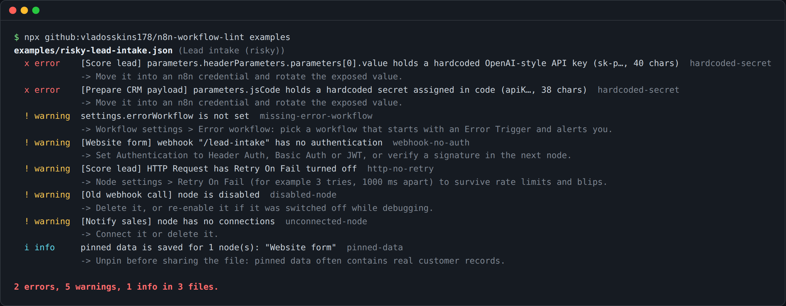

# n8n-workflow-lint

[](https://github.com/vladosskins178/n8n-workflow-lint/actions/workflows/ci.yml)
[](LICENSE)

A small command-line checker for exported [n8n](https://n8n.io) workflows. Point it at a workflow JSON file (or a folder of them) and it lists the problems that tend to bite in production: API keys pasted into nodes, open webhooks, no error workflow, HTTP calls without retries, and nodes that can never run.

No dependencies. Needs Node.js 20 or newer.



## Quick start

```bash
# run straight from GitHub
npx github:vladosskins178/n8n-workflow-lint my-workflow.json

# or clone it
git clone https://github.com/vladosskins178/n8n-workflow-lint.git
cd n8n-workflow-lint
node bin/n8n-workflow-lint.js examples
```

To get a workflow file: open it in n8n, then **... menu > Download**. To check everything on a self-hosted instance at once:

```bash
n8n export:workflow --all --output=workflows.json
npx github:vladosskins178/n8n-workflow-lint workflows.json
```

Both single-workflow files and `--all` exports (an array of workflows) are supported. Folders are scanned recursively; JSON files that are not workflows (like `package.json`) are skipped.

## Rules

| Rule | Severity | What it catches |
| --- | --- | --- |
| `hardcoded-secret` | error | API keys, bearer tokens, passwords in connection URLs, keys in query strings and secrets assigned in Code nodes. Recognises OpenAI, Anthropic, Stripe, GitHub, Slack, AWS, Google, Telegram bot tokens, JWTs and private keys, plus literal values under names like `X-API-Key`, `client_secret` or `Authorization`. The value is masked in the output. |
| `missing-error-workflow` | warning | `settings.errorWorkflow` is empty, so a failed production run goes unnoticed. Skipped for workflows that start with an Error Trigger. |
| `webhook-no-auth` | warning | Webhook nodes with Authentication set to None. |
| `http-no-retry` | warning | HTTP Request nodes with Retry On Fail turned off. |
| `disabled-node` | warning | Disabled nodes left in the workflow. |
| `unconnected-node` | warning | Nodes with no connections at all, and non-trigger nodes with no input (they never run). AI sub-nodes such as chat models, memory and tools are understood. |
| `pinned-data` | info | Pinned test data saved in the export, which often contains real customer records. |

Expressions (`={{ $env.API_KEY }}`) and obvious placeholders (`YOUR_API_KEY`, `<token>`) are not reported as secrets.

## Options

```text
-f, --format <text|json>   output format (default: text)
-d, --disable <rules>      comma-separated rule ids to skip
    --max-warnings <n>     exit with code 1 if there are more than n warnings
-q, --quiet                report errors only
    --no-color             disable colored output (NO_COLOR is respected too)
    --list-rules           print the available rules and exit
```

Exit codes: `0` no errors, `1` errors found (or more warnings than `--max-warnings`), `2` bad usage.

### Ignoring a finding on one node

Add a line to the node's **Notes** (node settings > Notes):

```text
n8n-lint-disable: http-no-retry
```

`n8n-lint-disable` on its own silences every rule for that node.

## Use it in CI

If you keep workflows in a Git repository, fail the build when a secret slips in:

```yaml
# .github/workflows/n8n-lint.yml
name: n8n lint
on: [push, pull_request]
jobs:
  lint:
    runs-on: ubuntu-latest
    steps:
      - uses: actions/checkout@v4
      - uses: actions/setup-node@v4
        with:
          node-version: 22
      - run: npx --yes github:vladosskins178/n8n-workflow-lint workflows/ --max-warnings 20
```

## Use it as a library

```bash
npm install github:vladosskins178/n8n-workflow-lint
```

```js
import { lintWorkflow } from 'n8n-workflow-lint';

const results = lintWorkflow(JSON.parse(json), { disable: ['pinned-data'] });
// [{ ruleId, severity, node, message, hint }, ...]
```

## Development

```bash
npm test                 # unit and CLI tests (node:test)
npm run lint:examples    # run the linter on the sample workflows
```

The `examples/` folder holds three sample workflows: a clean lead-intake flow, the same flow with every problem the linter knows about, and an AI agent with model and memory sub-nodes. The keys in the risky example are fake.

New rules live in [`src/rules.js`](src/rules.js). Each rule is an object with an `id`, a `severity` and a `check(workflow)` function that returns findings. Pull requests with new checks are welcome; please add a test and, if it helps, a sample workflow.

## License

[MIT](LICENSE) © 2026 Vladislav Y. Built at [VL Studio](https://vlstudio.app), where we build and repair automations for small businesses.
